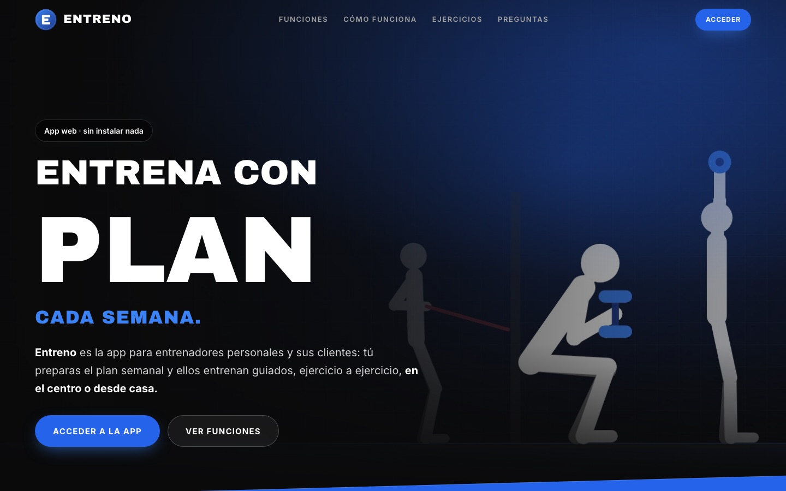
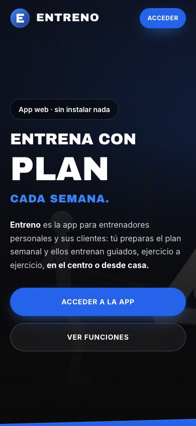
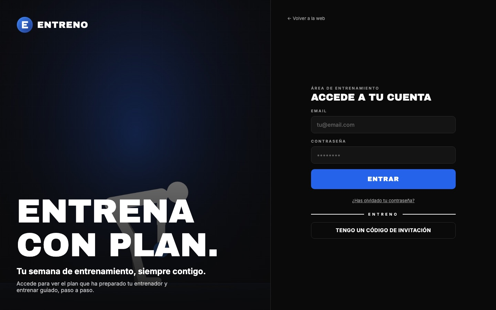

<div align="center">


# Entreno

**App web para entrenadores personales y sus clientes: planes semanales y entrenamiento guiado**

[Arquitectura](docs/ARQUITECTURA.md) · [Seguridad](docs/SEGURIDAD.md) · [Despliegue](docs/DESPLIEGUE.md) · [Changelog](CHANGELOG.md)

[](https://github.com/BeaFalagan/training-app/actions/workflows/ci.yml)
[](https://github.com/BeaFalagan/training-app/actions/workflows/security.yml)


[](LICENSE)

</div>

<p align="center">
  
  
</p>

## Qué es

Entreno nace de un proyecto real para un centro de entrenamiento personal. El problema: los entrenadores enviaban los planes por WhatsApp o en hojas de cálculo, y los clientes no sabían qué tocaba cada día, cuánto descansar ni cómo hacer cada ejercicio.

La solución son dos piezas que se despliegan juntas:

1. **Una web pública** estática, rápida y optimizada para buscadores y asistentes de IA.
2. **Una app web** en la que el entrenador prepara la semana de cada cliente y el cliente entrena guiado con temporizador.

Esta es la versión genérica y abierta del proyecto: el mismo código, con marca, imágenes y colores propios.

## Qué hace

**Entrenador**
- Panel «Esta semana» con el estado de cada cliente (sin plan, borrador, publicado) y su progreso.
- Planes semanales por días y bloques en 6 formatos: series, circuito, EMOM, AMRAP, Tabata y For Time.
- Repetir la semana anterior, duplicar o mover planes entre semanas.
- Alta de clientes con código de acceso compartible por WhatsApp, sin depender del envío de emails.
- Biblioteca de ejercicios compartida, con vídeo propio o ilustración animada.

**Cliente**
- Entrenamiento del día, material necesario y progreso semanal.
- Temporizador guiado: cuenta atrás, rondas, descansos, pitidos 3-2-1 y el ejercicio en curso animado.

**Administración**
- Altas y bajas de entrenadores y clientes, cambio de entrenador y códigos nuevos.

<p align="center">
  
</p>

## Decisiones técnicas

| Reto | Solución |
| --- | --- |
| **SEO y asistentes de IA** | Landing en HTML estático (el contenido no depende de JavaScript), datos estructurados `WebApplication` y `FAQPage`, `sitemap.xml` y `llms.txt`. Se sirve en `/` y la app en el resto de rutas desde el mismo despliegue. |
| **Seguridad sin servidor propio** | Toda la autorización vive en Postgres con Row Level Security. Las acciones privilegiadas (altas, códigos) pasan por Edge Functions que validan el rol. La web solo lleva la clave pública. |
| **Datos mínimos (RGPD)** | Solo se guardan nombre, email y planes de entrenamiento. Nada de datos de salud. |
| **Temporizador fiable** | El motor (`features/workout/engine.ts`) es lógica pura con tests: convierte los bloques en pasos y calcula el tiempo con marcas de tiempo, así que no se desvía aunque el navegador congele la pestaña. |
| **Ilustraciones sin coste** | 43 ejercicios animados con figuras vectoriales, fotogramas clave y cinemática inversa (`features/exercises/figure.ts`), en lugar de grabar y alojar vídeos. Las imágenes de la web también salen de ahí (`app/scripts/generate-art.mjs`). |
| **Material necesario** | Se deduce automáticamente de los ejercicios y cargas del plan: pesos de mancuerna, color de cada goma, comba… |
| **Acceso sin servidor de correo** | Códigos de acceso temporales de 8 caracteres que el entrenador envía por WhatsApp; el cliente crea su contraseña al entrar. |

## Stack

| Capa | Tecnología |
| --- | --- |
| App web | Expo SDK 58 · React Native Web · React 19 · TypeScript estricto · Expo Router · TanStack Query |
| Web pública | HTML y CSS estáticos, sin framework |
| Backend | Supabase: Postgres 17 con RLS, Auth, Storage y Edge Functions (Deno) |
| Hosting | Vercel (web) · Supabase (datos) |
| Calidad | TypeScript estricto · ESLint · tests con `node:test` · GitHub Actions (CI, CodeQL, gitleaks, Dependabot) |

## Estructura

```
.
├── app/                     App web (Expo) y landing
│   ├── src/app/             Rutas: (auth), (trainer), (client), workout…
│   ├── src/features/        Lógica por dominio: plans, workout, exercises, clients, admin…
│   ├── src/components/      Sistema de diseño y layout de escritorio
│   ├── landing/             Web pública estática y ficheros SEO
│   └── scripts/             build-web.mjs (landing + app) · generate-art.mjs (imágenes)
├── supabase/
│   ├── migrations/          Esquema, políticas RLS y cambios de base de datos
│   ├── functions/           Edge Functions: invite-client · admin-users
│   └── seed/                Datos iniciales
├── docs/                    Arquitectura, despliegue, seguridad y roadmap
└── .github/                 CI, seguridad, Dependabot y plantillas
```

## Ejecutarlo en local

Requisitos: **Node 24** (ver `.nvmrc`), un proyecto de [Supabase](https://supabase.com) y su [CLI](https://supabase.com/docs/guides/cli).

```bash
npm install                          # instala también las dependencias de app/
cp app/.env.example app/.env.local   # URL y clave pública de tu proyecto Supabase
supabase link --project-ref <ref>
supabase db push                     # crea el esquema y las políticas
npm run dev                          # http://localhost:8081
```

| Comando | Qué hace |
| --- | --- |
| `npm run dev` | App en el navegador con recarga en caliente |
| `npm run check` | Tipos, lint y tests (lo mismo que la CI) |
| `npm run build:web` | Build de producción (landing + app) en `app/dist` |

Guía completa, incluido el primer administrador, en [docs/DESPLIEGUE.md](docs/DESPLIEGUE.md).

## Licencia

[PolyForm Noncommercial 1.0.0](LICENSE): puedes leer, estudiar y usar el código con fines no comerciales. Para uso comercial, contacta conmigo.

---

<sub>Diseñado y desarrollado por <a href="https://github.com/BeaFalagan">Beatriz Falagán</a>.</sub>
