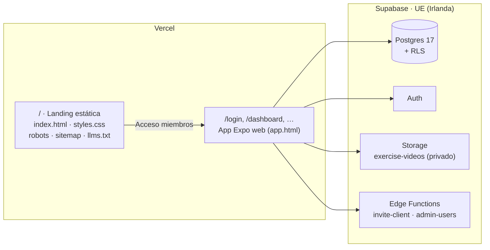
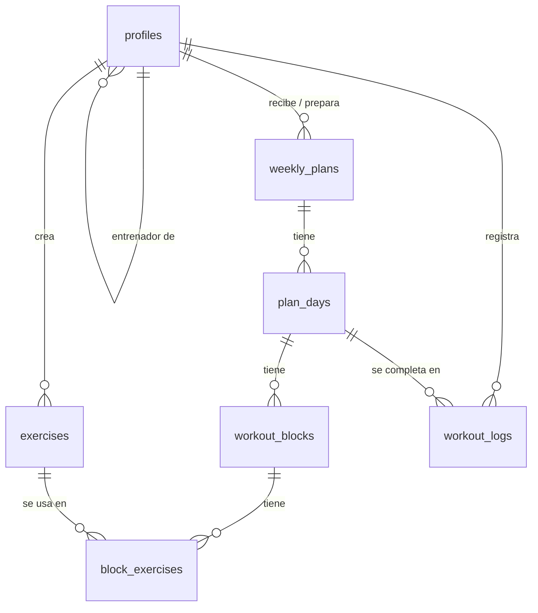

# Arquitectura

## Visión general

- **App web** (`app/`) hecha con Expo y React Native Web, servida junto a la landing.
- **La landing es independiente**: HTML y CSS estáticos en `app/landing/`, para que buscadores e IAs la lean completa y cargue al instante.
- **Sin servidor propio**: la lógica de negocio sensible se reparte entre las políticas de Postgres (RLS) y las Edge Functions.

## Build web

`app/scripts/build-web.mjs` (lo ejecuta Vercel):

1. `expo export -p web` genera la SPA de la app en `app/dist`.
2. Renombra su `index.html` a `app.html` y le añade `noindex`.
3. Copia `app/landing/` a la raíz de `dist`, con lo que la landing pasa a ser `index.html`, y las fotos a `/img`.

`vercel.json` sirve primero los archivos que existen (landing, imágenes, JS) y reescribe el resto de rutas a `/app`, así `/login` o `/plan/123` cargan la app. También añade cabeceras de seguridad y caché.

## App (`app/src`)

| Carpeta | Contenido |
| --- | --- |
| `app/` | Rutas de Expo Router. `(auth)` login · `(trainer)` entrenador y administración · `(client)` cliente · `workout/` resumen, temporizador y cierre |
| `features/` | Lógica por dominio con hooks de TanStack Query: `auth`, `clients`, `plans`, `exercises`, `logs`, `admin`, `workout` |
| `components/ui` | Sistema de diseño: `Screen`, `Grid`, `Columns`, `Button`, `Select`, `Card`… |
| `components/web` | Menú lateral (`Sidebar`/`WebShell`) y pantalla de acceso de escritorio (`AuthShell`) |
| `lib/` | Cliente de Supabase, fechas, avisos (`showAlert`), adaptación a pantalla (`useIsDesktop`, `useColumns`) |
| `theme/` | Colores, tipografías y espaciados de la marca |

### Diseño adaptable
- **Pantallas estrechas (< 900 px):** pestañas inferiores y contenido apilado.
- **Escritorio (≥ 900 px):** menú lateral fijo, contenido a todo el ancho, cuadrículas con columnas según el espacio y editores en dos columnas.

### Piezas clave
- **Motor de entrenamiento** (`features/workout/engine.ts`): convierte los bloques de un día en pasos con cuenta atrás. El tiempo se calcula con marcas de tiempo, así que no deriva aunque la app se pause. Es lógica pura y tiene tests.
- **Ilustraciones animadas** (`features/exercises/figure.ts`): figuras vectoriales con fotogramas clave y cinemática inversa, que se usan cuando un ejercicio no tiene vídeo.
- **Avisos** (`components/AlertHost.tsx`): ventanas propias con la estética de la marca y todas las opciones a la vista.

## Modelo de datos

| Tabla | Para qué |
| --- | --- |
| `profiles` | Usuario: nombre, email, rol (`trainer`/`client`), entrenador asignado, `is_admin` |
| `exercises` | Biblioteca compartida: vídeo o ilustración, grupo muscular, claves técnicas |
| `weekly_plans` → `plan_days` → `workout_blocks` → `block_exercises` | Plan semanal (borrador o publicado) |
| `workout_logs` | Entrenamiento completado: fecha, duración y rondas |

La función SQL `duplicate_plan` copia un plan completo a otra semana («Repetir semana»).
